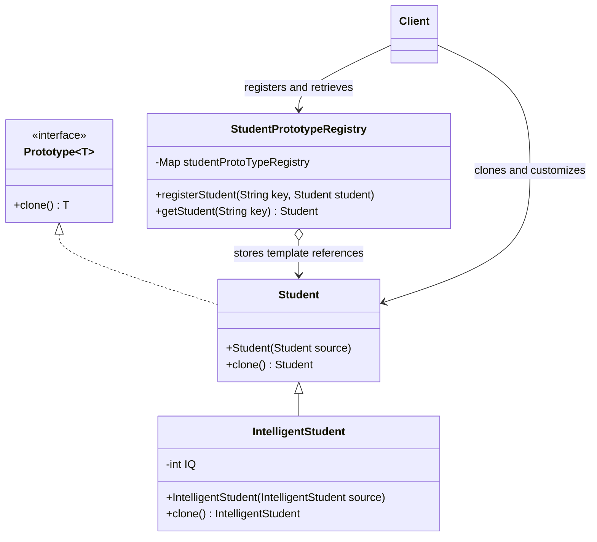

# Prototype Pattern with Registry in Java

### Configure a template once. Clone it by key. Customize the new instance.

A focused **Java object-oriented design example** combining a generic prototype contract, copy constructors, inheritance, and a named registry. The client retrieves a preconfigured student template, clones it, and sets instance-specific values while retaining shared batch settings.

The example also demonstrates subtype-preserving cloning: an `IntelligentStudent` stored behind a `Student` reference creates another `IntelligentStudent` through its overridden method.

[Source on `master`](https://github.com/FaiazS/Prototype-Design-Pattern-with-Registry-in-Java/tree/master/src/main/java/PrototypeDesignPattern) · [Registry](https://github.com/FaiazS/Prototype-Design-Pattern-with-Registry-in-Java/blob/master/src/main/java/PrototypeDesignPattern/StudentPrototypeRegistry.java) · [Client](https://github.com/FaiazS/Prototype-Design-Pattern-with-Registry-in-Java/blob/master/src/main/java/PrototypeDesignPattern/Client.java)

> **Branch guide:** The default `main` branch contains documentation only. Java source and Maven configuration are on **`master`**. This is an in-memory design-pattern example, not a student-management service. No compilation or tests were run for this documentation.

---

## The design problem

When several objects share a set of defaults, repeating their initialization throughout client code can obscure which values belong to the template and which belong to an individual instance.

This project separates those steps:

1. Configure batch-level prototype objects.
2. Register them under descriptive keys.
3. Retrieve and clone the selected prototype.
4. Customize the clone's name, age, and PSP.

The practical value is reusable initialization and explicit copy behavior. The repository does not benchmark cloning against ordinary construction, and cloning still allocates a new object through a constructor.

## Architecture



## Components

| Type | Responsibility |
|---|---|
| `Prototype<T>` | Declares `T clone()` |
| `Student` | Stores student and batch fields; copies them through a copy constructor |
| `IntelligentStudent` | Adds an integer `IQ` field and overrides cloning |
| `StudentPrototypeRegistry` | Maps string keys to student prototype references |
| `Client` | Configures two templates, clones them, and customizes the results |

`IQ` is a sample data field, not a measured assessment result or an implemented intelligence test.

## Copy implementation

The base clone delegates to an explicit constructor:

```java
@Override
public Student clone() {
    return new Student(this);
}
```

That constructor copies `name`, `age`, `psp`, `batch`, `avgBatchPSP`, and `counter`. The subclass constructor calls `super(source)` and then copies its own `IQ` field.

The implementation does not use `Object.clone()`, `super.clone()`, or Java's `Cloneable` marker interface. Its behavior is defined by the constructors in this repository.

### Copy depth

Current fields are primitives and immutable `String` references. A clone is a distinct object, with primitive values copied and string references shared safely under string immutability. Setter calls on a clone do not reassign fields on the prototype.

There are no nested mutable objects or collections in the model, so this example does not demonstrate recursive deep copying. Adding such fields would require an explicit decision about copying versus sharing them.

### Subtype preservation

`IntelligentStudent.clone()` returns `new IntelligentStudent(this)` using a covariant return type. Although registry lookup returns `Student`, dynamic dispatch invokes the subclass override when the template is an `IntelligentStudent`.

The runtime clone preserves that subtype. A variable declared as `Student` still exposes only the base-type API unless the caller explicitly handles the subtype.

## Registry behavior

The registry wraps a `HashMap<String, Student>`:

- `registerStudent` uses `putIfAbsent`.
- `getStudent` returns the stored reference when the key exists.
- Missing keys return `null`.
- Cloning happens in the client, not automatically during retrieval.

For an existing non-null mapping, registration does not replace the template. Null mappings and arguments are not validated. The registry is mutable, in-memory, and unsynchronized.

Returning the stored template exposes it to modification. A caller that changes the retrieved object without cloning also changes the defaults used by later clones. Calling `.clone()` after a missing lookup causes a null-reference failure.

## Committed client example

The client registers:

| Key | Runtime template type | Batch | Average batch PSP |
|---|---|---|---:|
| `may23StudentPrototype` | `Student` | May 23 Batch | 95.0 |
| `apr23StudentPrototype` | `IntelligentStudent` | April 23 Batch | 98.0 |

It then creates two clones:

| Clone name | Age | Individual PSP | Inherited batch |
|---|---:|---:|---|
| `FaiazAhmed` | 30 | 90.0 | May 23 Batch |
| `FaiazAhmedA` | 30 | 92.0 | April 23 Batch |

These values describe example object initialization, not claims about actual academic records. The subclass template does not set its `IQ`, so the copied value remains Java's default integer value of zero.

The committed client only prints:

```text
DEBUG
```

It does not print clone fields, compare object identities, or assert copy independence. The tables above are derived from source inspection, not captured runtime output.

## Build and run

The Maven file targets **Java 23** and declares no external dependencies.

```bash
git clone --branch master https://github.com/FaiazS/Prototype-Design-Pattern-with-Registry-in-Java.git
cd Prototype-Design-Pattern-with-Registry-in-Java
mvn compile
java -cp target/classes PrototypeDesignPattern.Client
```

Use JDK 23 to match the compiler configuration, with Maven installed. Select `PrototypeDesignPattern.Client` as the IDE entry point. These commands describe the intended source execution path; they were not run for this review.

## Source layout on `master`

```text
Prototype-Design-Pattern-with-Registry-in-Java/
├── pom.xml
├── .gitignore
└── src/main/java/
    ├── com/scaler/
    └── PrototypeDesignPattern/
        ├── Prototype.java
        ├── Student.java
        ├── IntelligentStudent.java
        ├── StudentPrototypeRegistry.java
        └── Client.java
```

IDE metadata is also committed. No persistence layer, network API, benchmark, or automated test suite is included in the reviewed source layout.

## Design tradeoffs and useful extensions

1. **Make copy behavior observable:** Replace the debug-only print with a clear demonstration of retained defaults, customized fields, distinct identities, and subclass preservation.
2. **Protect templates:** Consider a clone-returning lookup or immutable template objects if callers should not mutate registered prototypes.
3. **Define missing-key behavior:** Use a documented exception or explicit optional result rather than an unchecked null chain.
4. **Specify registration rules:** Decide whether duplicates should be ignored, rejected, or replaced, and validate nulls.
5. **Demonstrate mutable-field copying:** Add a nested value only if needed, then explicitly implement and verify its copy semantics.
6. **Handle subtype evolution:** New subclasses with extra fields must provide appropriate copying behavior; inheriting the base clone would create a plain `Student`.
7. **Add focused tests when extending:** Check copied values, mutation independence, registry behavior, and runtime subtype.

These are proposed improvements, not completed features.

## Skills demonstrated

**Java · Prototype pattern · Registry pattern · Generics · Copy constructors · Inheritance · Dynamic dispatch · Covariant returns · HashMap · Object-state management**

The strongest portfolio contribution is a clear object-creation workflow: store configured templates, copy through the appropriate runtime implementation, and customize new instances without repeating every default assignment.

---

**Author:** [Faiaz Ahmed](https://www.linkedin.com/in/faiazahmed22/) · [GitHub](https://github.com/FaiazS)

